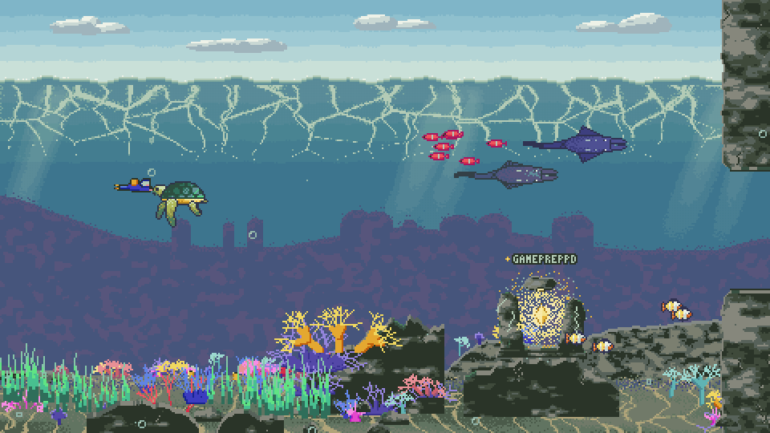

# Deep Diver

A retro pixel-art dive through the GitHub repositories of [`y0c0ms`](https://github.com/y0c0ms). You swim through a reef, a kelp forest and a deep cave; every public, non-fork repository is a glowing shrine. Swim up to one and its details and README pop up.

**Play:** https://y0c0ms.github.io/CareerDive/



## Controls

| | Desktop | Phone / tablet (landscape) |
|---|---|---|
| Swim left / right | `A` `D` or arrow keys | drag the joystick (bottom-left) left / right |
| Rise / dive | `W` `Space` / `S` or `Up` / `Down` | drag the joystick up / down |
| Boost | hold `Shift` | hold the round BOOST button (bottom-right) |
| Close popup | `Esc` or the X button | tap the X button |
| Restart after a crash or at the end | `R` | tap the screen |
| Show / hide the key hints | `H` or `?` | tap the HUD |

Without input the diver slowly sinks. The top bar shows distance, shrines found (with a progress bar), your 3 hearts and the boost meter; the key caps on the right shrink to a compact version after a few seconds.

* **Boost** swims about 1.7x faster with a trail of bubbles. The meter lasts about 3 s of full boost and refills in about 4 s; it cannot start below 15 % and stays empty until you release the key or button.
* **Hearts:** jellyfish and the cave anglerfish (watch the glowing lure) cost one heart, with a knockback and 1.2 s of blinking invulnerability. At zero hearts you are CRASHED. Rock pillars still crash instantly. Fish, turtles, mantas, crabs, seahorses, starfish and octopuses are harmless.
* Reach the end of the world for "EXPLORATION COMPLETE". On a phone held in portrait the game pauses and asks you to rotate to landscape.
* **On phones** the view is zoomed out (about 1.45x more world visible, all of it from sky to seabed, with extra sky and bedrock filling tall screens). The diver is held about 42 % from the left, clear of the 100 px joystick (bottom-left) and the boost button (bottom-right); the camera may scroll past the ends of the world, where a rock cliff stands. The layout follows `visualViewport`/`100dvh`, so the browser's URL bar does not crop the world.

## How it uses the GitHub API

* On start it calls `GET https://api.github.com/users/y0c0ms/repos?per_page=100` (forks and the repos listed in `IGNORED_REPOS` in `js/data.js` are skipped) and, when a shrine popup opens, `GET /repos/<owner>/<repo>/readme` with `Accept: application/vnd.github.v3.raw`.
* Successful responses are cached in `localStorage` for one hour, so a reload does not spend the unauthenticated rate limit (60 requests/hour per IP).
* If anything fails (offline, rate limit, 403, timeout after 6 s) the game falls back to the bundled snapshot in `data/` (`repos.json`, `readme-index.json`, `readme/*.md`). It never shows an empty screen because GitHub is unreachable. Refresh the snapshot by re-downloading the same API responses into that folder, keeping the structure.
* README Markdown is rendered with the vendored `marked`, then sanitised (scripts, `on*` handlers, iframes removed; relative image URLs rewritten to `raw.githubusercontent.com`; links open in a new tab).

## README tips for the best popup

The popup promotes the first real picture of a repo's README to a hero banner and shows the rest of the README below it.

* Put a **GIF or screenshot first** in the README (under about 5 MB; use relative paths such as `docs/demo.gif`, they are resolved against the repo's default branch on `raw.githubusercontent.com`).
* The repo must be **public**, and the image must not be stored in Git LFS (LFS files do not load from `raw.githubusercontent.com`).
* **Badges do not count** (shields.io, build/CI/coverage badges, any image smaller than 120 px); they stay in the text.
* A video works too: a drag-and-dropped `.mp4` in the README (a `github.com/user-attachments/assets/...` link) or a link to a `.mp4`/`.webm` becomes a muted, looping inline video.
* No picture? The popup simply shows the text layout. A broken image falls back to it as well.

## The world is procedural

World width is `1600 + repos * 1100` px. Zones (reef, kelp forest, cave) are thirds of that width with 600 px blends. Shrine design, mount (seabed, rock ledge, floating, hanging, cave ceiling) and position derive from a fixed seed plus a hash of each repo's `full_name`; rock pillars, corals, kelp and wildlife are generated per 512-px segment from the segment index. Adding a repo only appends to the world: earlier shrines keep their positions. Textures are tiled or pooled, so memory does not grow with the number of repos (`node tools/scale-test.cjs` shows this for 5, 22 and 60 repos).

Shrine colour follows the primary language (`LANG_ACCENT` in `js/world.js`, other languages get a stable hash colour) and size follows the star count (0, 1-2, 3+).

## Layout

```
index.html  style.css  game.js       page, UI styling, Phaser scene and the window.__test hook
js/art.js        palette + procedural art recipes (rocks, corals, kelp, sand, caustics, fish, jellyfish, diver)
js/wildlife.js   sardines, clownfish, pufferfish, turtle, manta, crab, seahorse, starfish, octopus, anglerfish
js/shrines.js    ten shrine designs and their animated glow
js/world.js      pure layout: zones, shrines, pillar gates
js/scenery.js    sprite library, zone blending, label font
js/segments.js   per-segment decoration and fauna
js/data.js       GitHub fetch + cache + offline fallback
js/hud.js        pixel-font HUD canvas and boost button
js/enemies.js    jellyfish / anglerfish hitboxes, hot sprites, patrol
js/ui.js         popup, joystick, boost button, rotate overlay, keyboard
data/            bundled offline snapshot of the GitHub data
vendor/          Phaser 3.80.1, marked
tools/           verify, device-test, gameplay-test, popup-test, scale-test, make-preview
```

No build step, no CDN, no web fonts, no image files: it runs from any static host under any sub-path (`.nojekyll` is included for GitHub Pages).

## Testing and regenerating the preview

Needs Node, `puppeteer-core`, Chromium and `ffmpeg`.

```sh
export PUPPETEER_CORE=/path/to/node_modules/puppeteer-core
node tools/verify.cjs --out verify-out --sizes 1280x720,1920x1080   # functional + visual checks
node tools/device-test.cjs --out device-out                          # touch, portrait overlay, offline, cache
node tools/gameplay-test.cjs --out gameplay-out                      # boost, hearts, enemies, spawn rules
node tools/popup-test.cjs --out popup-out                            # popup hero layout
node tools/scale-test.cjs --out scale-out                            # 5 / 22 / 60 repos
node tools/make-preview.cjs                                          # writes preview.gif and preview.png
```

The test tools answer the GitHub URLs from `data/`, so they run offline. Serve the folder with any static server (`python3 -m http.server`) to play locally; opening `index.html` from `file://` blocks the bundled-data `fetch`.
